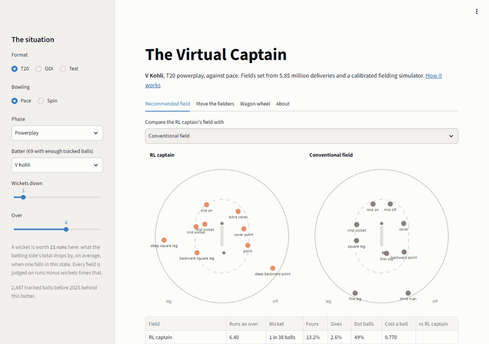
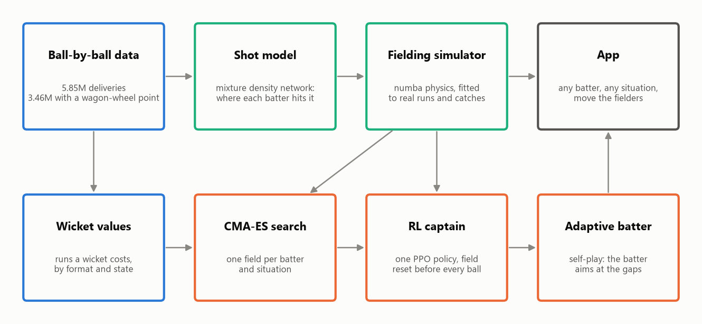
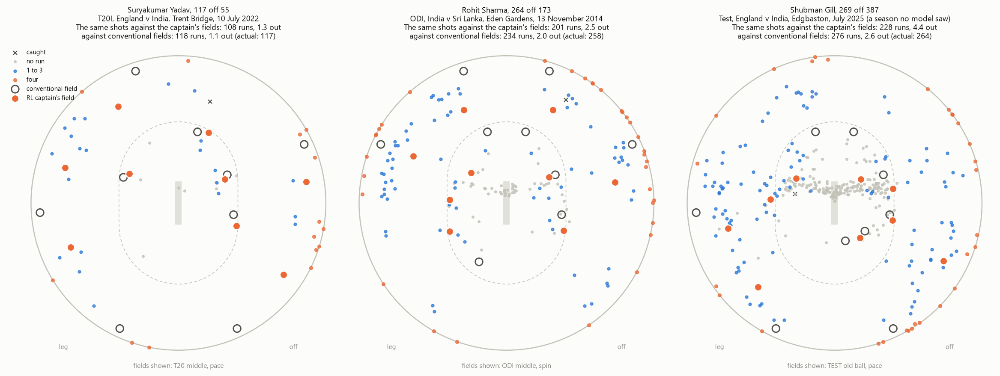
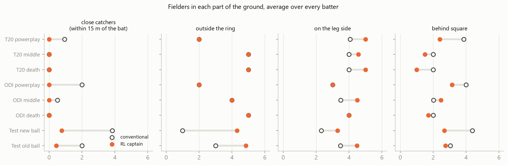

# The Virtual Captain

[](https://github.com/mehulp007/The-Virtual-Captain/actions/workflows/ci.yml)

[](LICENSE)
[](https://the-virtual-captain.streamlit.app)

**Where should the nine fielders stand against this batter, in this situation?** Captains answer
that on instinct. The Virtual Captain answers it from data, for Test, ODI and T20 cricket:

- a **shot model** that learned where batters hit the ball from 5.85 million deliveries
  (2001–2026),
- a **fielding simulator** fitted to real runs, boundaries and catches,
- a **reinforcement-learning captain** that sets the field before every ball for any batter,
  hardened by self-play against a batter who aims for the gaps.



**Live app: [the-virtual-captain.streamlit.app](https://the-virtual-captain.streamlit.app)**.
Pick a batter and a match situation, see the captain's field next to the textbook one, then move
the fielders yourself and watch the cost change.

## Key results

- **Fields set for the batter beat the textbook.** Across 60 batter scenarios an optimised field
  concedes 1.23 runs a ball in T20s against 1.36 for the conventional field (about 16 runs an
  innings). It beats a field built from the batter's wagon wheel in all 40 checks on unseen
  2025–26 seasons.
- **One policy keeps up with a dedicated search for every batter.** The RL captain beats
  per-batter CMA-ES searches in 61% of 1,024 batter contexts, saves 0.017 runs a ball over whole
  T20 overs, and wins 49 of 72 contexts on real 2025–26 deliveries.
- **It is hard to exploit.** Self-play cuts what a batter who knows the field can gain by 6% in
  T20s and 17% in ODIs.
- **Famous innings shrink.** Replayed against the captain's fields, Suryakumar Yadav's 117 off 55
  comes to about 108, and Shubman Gill's 269, from a season no model saw, loses about 35 runs.

## How it works



| Stage | What it does | How it was checked |
|---|---|---|
| **Data** | 5.85M deliveries joined with Cricinfo tracking; 3.46M carry a wagon-wheel point | coverage by format and era |
| **Shot model** | A mixture density network predicts contact, then direction, distance and whether the ball is in the air, for a given batter, bowler, delivery and situation | negative log-likelihood 1.18 on unseen 2025–26 shots, against 1.66 for each batter's own wagon wheel |
| **Simulator** | Numba physics: fielders react, run, dive and catch; batters run when there is time. About 6M deliveries a second | runs per ball within 8% of reality on unseen seasons |
| **Wicket value** | What a wicket costs the batting side, from the data: 13 runs in a T20 powerplay, 3 at the death, 38 in a Test | every field is judged on runs minus wickets times that |
| **Search** | CMA-ES over all nine positions, legal fields only | beats a field built from the batter's wagon wheel in 60 of 60 scenarios |
| **RL captain** | One PPO policy moves the nine fielders before every ball, from the match state and both batters' profiles | judged on deliveries it never trained on, and on batters it never saw |
| **Self-play** | An adaptive batter picks how hard to attack and where to aim, at a risk fitted from the data; captain and batter train against each other | a fresh best-response batter for every field (exploitability) |
| **App** | Streamlit; the policy runs in NumPy and scores each field on about 50,000 simulated balls in well under a second | tests match it to the trained policy exactly |

## Results

**Optimised fields against the textbook.** Average over 60 batter scenarios, on deliveries the
search never saw:

| Runs per ball | Conventional | Built from the wagon wheel | Optimised |
|---|---:|---:|---:|
| T20 | 1.36 | 1.31 | **1.23** |
| ODI | 0.96 | 0.90 | **0.83** |
| Test | 0.58 | 0.52 | **0.49** |

**The RL captain over whole overs.** Strike changes, wickets fall and a wicket's value moves with
the match. Cost per ball against switching to each striker's dedicated searched field (below
zero is better):

| | Conventional | Best field for all batters | RL captain |
|---|---:|---:|---:|
| T20 | +0.157 | +0.005 | **−0.017** |
| ODI | +0.168 | +0.005 | **−0.007** |
| Test | +0.196 | +0.008 | +0.001 |

**Against a batter who adapts.** Runs per ball a best-response batter gains over its natural game
(lower is harder to exploit):

| | All-batters field | Searched field | Captain before self-play | Captain after |
|---|---:|---:|---:|---:|
| T20 | 0.329 | 0.327 | 0.328 | **0.308** |
| ODI | 0.140 | 0.144 | 0.146 | **0.122** |
| Test | 0.109 | **0.088** | 0.103 | 0.096 |

Most of that gain comes from attacking harder, which no placement of nine fielders can take away.

### Three famous innings

Every real shot is replayed against fields set for that batter at the match state of that very
ball, with 200 rounds of fielding luck per shot:

| Innings | Actual runs | RL captain | Conventional |
|---|---:|---:|---:|
| Suryakumar Yadav, 117 off 55, Trent Bridge 2022 | 117 | **108** runs, 1.3 out | 118 runs, 1.1 out |
| Rohit Sharma, 264 off 173, Eden Gardens 2014 | 258 | **201** runs, 2.5 out | 234 runs, 2.0 out |
| Shubman Gill, 269 off 387, Edgbaston 2025 | 264 | **229** runs, 4.4 out | 276 runs, 2.6 out |



Against the conventional field the simulator lands within a run of Suryakumar's real 117. A
batter facing a different field would have played differently, so this shows only how the same
shots would have fared.

### Where it parts from the textbook



The captain gives up the slip cordon, puts about one more fielder on the leg side and sets deeper
Test fields. The leg-side shift follows where runs really go and is well supported. The missing
slips are partly a blind spot of the simulator, which can't place edges precisely enough to value
a full cordon.

## Limitations

- **Nobody recorded where fielders stood**, so everything about fielders comes from the simulator.
  Comparisons between fields are fair; their ranking is more reliable than the exact runs saved.
- **Catches are the weakest part.** The simulator under-counts slip and close catches, so Test
  fields are the least trustworthy.
- **A wagon-wheel point is where the ball was stopped,** not where it would have gone, and a shot
  counts as aerial only if it was caught or dropped.
- **The captain moves fielders for free** between balls and doesn't play for the strike.
- Men's cricket only; run-outs, overthrows, extras and ground sizes are not modelled.

## Run it

Requires [uv](https://docs.astral.sh/uv/) and a free
[Kaggle API token](https://www.kaggle.com/docs/api). About nine hours on a laptop with an
RTX 4060:

```bash
uv sync --extra cu128 --extra app            # --extra cpu without an NVIDIA GPU
uv run python scripts/reproduce.py           # data, models, results and figures
uv run streamlit run app/streamlit_app.py    # the app, locally
```

`scripts/reproduce.py --list` shows the 13 steps, each a script in `scripts/` that also runs on
its own. Training runs are logged to MLflow in `mlruns/`. Tests: `uv run pytest`.

## Repository

```
app/                    entry point for Streamlit Community Cloud
configs/                fielding restrictions per format, fitted simulator parameters
scripts/                one script per step, plus reproduce.py and make_figures.py
src/virtual_captain/
  data/  models/        deliveries table, features, shot model
  field/  sim/          positions, fielding rules, simulator and its calibration
  optim/                wicket values, CMA-ES search, sensitivity
  rl/                   captain environment, adaptive batter, self-play
  app/  viz/            the app (data bundle, engine, pages) and figure drawing
docs/methods.md         every component in detail: method, results, limitations
reports/                results as CSV and JSON, figures, the write-up
notebooks/  tests/
```

**Further reading:** [docs/methods.md](docs/methods.md) for the full method and results, and
[reports/writeup.md](reports/writeup.md) for the story of the project.

## Data and licence

| Source | What it provides |
|---|---|
| [The Ultimate Ball-by-Ball Cricket Dataset](https://www.kaggle.com/datasets/ariadaikalam/the-ultimate-ball-by-ball-cricket-dataset) | Every ball of international and major T20 league cricket, joined with Cricinfo tracking: wagon-wheel position, line, length, shot and control |
| [Cricsheet](https://cricsheet.org/) | Open ball-by-ball match data |

Raw data is never committed; `scripts/download_data.py` fetches it. Code is MIT licensed.
Cricsheet data is used under the Open Data Commons Attribution License; tracking fields derived
from ESPNcricinfo are used for non-commercial purposes only, with credit to ESPNcricinfo.
