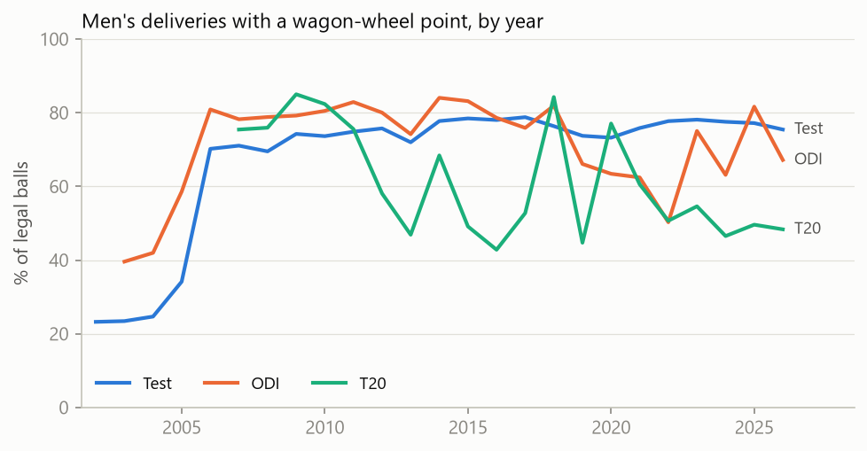
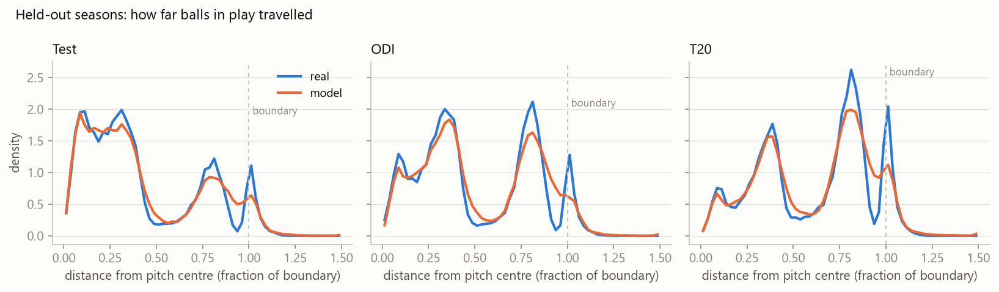
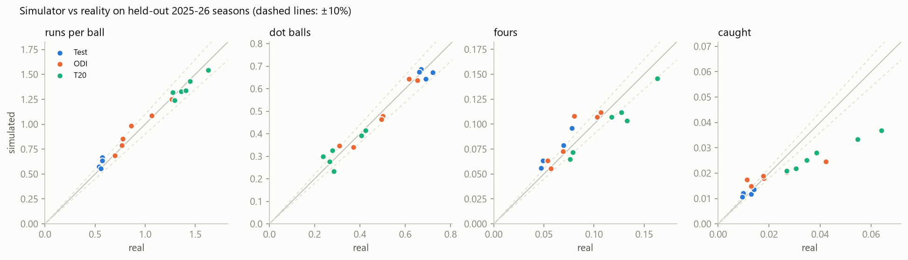
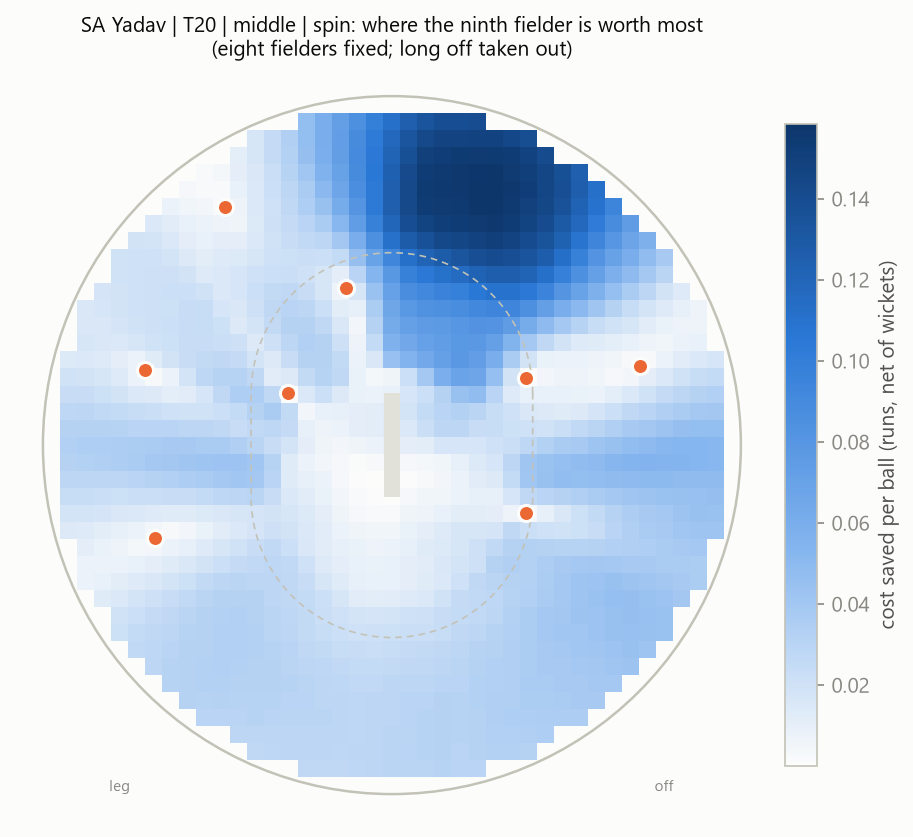

# The Virtual Captain

[](https://github.com/mehulp007/The-Virtual-Captain/actions/workflows/ci.yml)

[](LICENSE)

Field placement in cricket is mostly set on instinct. This project looks at it as a data problem:
given where a batter tends to hit the ball, against a particular type of bowling, where should the
nine fielders stand?

It works from 5.85 million deliveries of Test, ODI and T20 cricket (2001–2026), 3.46 million
of which carry a wagon-wheel point showing where the ball went.


## What the data shows so far

The same batter scores in very different places depending on the ball they get, which is the
whole case for setting a field per batter and per situation rather than per format:

- **Length decides the side of the wicket.** Only 27% of runs off short balls come on the off
  side, against 51% off full balls and yorkers.
- **So does the direction of spin.** Against spin turning away, 44–48% of runs go to the off side;
  against spin turning in, 35–41%.
- **Formats change the shape, not just the volume.** In Tests, 22% of Kohli's runs come through
  the cover region and 23% through mid-wicket. In T20s that becomes 17% and 26%.


| | |
|---|---|
|  |  |

More in [`notebooks/01_eda.ipynb`](notebooks/01_eda.ipynb).

## Shot model

A neural network that predicts what happens when a ball is bowled, before any fielder is
involved. It is trained on 3.3 million men's deliveries up to 2024 and tested on the 2025–26
seasons, which it never saw.

Given the batter, the bowler, line and length, bowler type, format, phase, match situation and
venue, it outputs:

- **Contact:** the chance the ball is left or missed, the chance it bowls / traps lbw / stumps the
  batter (dismissals no field can prevent), the chance it is hit for six (also decided by the
  batter, not the field), and the chance it is put into play.
- **The shot:** for any other ball put into play, a joint distribution over **direction**,
  **distance** and
  whether it went **in the air**. This is a mixture density network with 16 components; each
  component has its own direction (von Mises), its own chance of being aerial, and separate
  distance distributions (log-normal) for ground and aerial balls. Edges flying behind the wicket,
  lofted hits and pushes into the ring come out as different components.

Batters and bowlers are represented by learned embeddings, so the model can say how a specific
batter plays a specific kind of ball while batters with little data fall back on what similar
batters do.

### How well it predicts unseen seasons

Average negative log-likelihood on 2025–26 (lower is better):

| | Shot model | Per-batter histogram | Everyone pooled |
|---|---:|---:|---:|
| Contact outcome, per ball (395k balls) | **0.563** | 0.630 | 0.657 |
| Shot, per ball in play (317k shots) | **1.175** | 1.658 | 1.687 |

The per-batter histogram is a strong, honest baseline: each batter's own shot chart, smoothed
towards the population with a strength picked on validation data. The model assigns real shots
about 1.6× the likelihood the histogram does.


Most of that gain comes from the delivery itself (line, length, bowler type and phase), not from
knowing who the batter is. Swapping a batter's embedding for the "average batter" one shows how
much identity adds on unseen seasons:

| Batter's balls in training | 300–800 | 800–2,000 | 2,000–6,000 | 6,000+ |
|---|---:|---:|---:|---:|
| Shot NLL improvement from knowing the batter | −0.001 | 0.016 | 0.029 | 0.038 |

It grows with the amount of data, and for batters with little history it falls back to roughly
the average batter rather than overfitting, which is what the pooling should do.

Simulated rates line up with reality by format and phase (full table in
[`reports/shot_model_calibration.csv`](reports/shot_model_calibration.csv)):

| Held-out 2025–26 | Real in play | Sim | Real six | Sim | Real aerial | Sim | Real off side | Sim |
|---|---:|---:|---:|---:|---:|---:|---:|---:|
| Test, new ball | 71.3% | 70.7% | 0.4% | 0.6% | 2.2% | 2.4% | 60.2% | 60.1% |
| ODI, middle | 88.4% | 86.5% | 1.6% | 1.9% | 2.1% | 2.3% | 56.5% | 57.6% |
| T20, death | 74.8% | 73.4% | 9.4% | 9.2% | 10.1% | 9.6% | 50.8% | 50.2% |



### Known limitations

- **A wagon-wheel point is where the ball was stopped, not where it would have gone.** The
  distance curves above show the field as much as the batter: the bump at about 0.8 of the
  boundary is where boundary riders stop the ball, and almost nothing is recorded just inside the
  rope. The model smooths over that gap. Distances for fielded balls are therefore a lower bound
  on how far the shot would have travelled.
- **"In the air" is only observed when it matters.** A ball is labelled aerial if it was caught
  or dropped. Lofted shots that landed safely in a gap look like ground balls.
- **Batting is drifting.** Limited-overs batters put more balls into play in 2025–26 than in
  any training year, so the model under-predicts contact by up to 3 points on those seasons. On
  validation matches from the training years it is within half a point.
- Men's cricket only.

## Fielding simulator

The simulator replays deliveries against a field and works out what each one is worth. It runs
about 6 million deliveries a second on a 16-core laptop CPU (compiled with Numba).

**Fielding restrictions** ([`src/virtual_captain/field/rules.py`](src/virtual_captain/field/rules.py)),
for the nine fielders other than bowler and keeper:

- no more than two behind square on the leg side, in every format
- at most 2 outside the 30-yard ring in the T20 powerplay and 5 after it; in ODIs 2 / 4 / 5 across
  overs 1-10, 11-40 and 41-50; no limit in Tests
- inside the boundary, off the pitch and not on top of the striker

Any field can be repaired into a legal one: the fewest fielders are moved, by the smallest
distance, until every rule holds. 32 named positions and 16 conventional fields (by format,
phase and pace or spin) are defined in [`src/virtual_captain/field`](src/virtual_captain/field).

**Physics, ball by ball.** The shot model decides whether the ball is put into play and, if so,
its direction, distance and whether it is in the air. Then:

- **Along the ground** the ball slows at a constant rate. Each fielder needs a reaction time,
  then runs at a fixed speed and can dive a little way; the first fielder who can get to the
  ball's line before it does stops it.
- **In the air** the hang time grows with the square root of the distance hit, as for a
  projectile. A fielder who reaches the landing spot in time holds the catch, less reliably the
  less time they had; otherwise it lands, rolls on and has to be chased.
- **Edges** (anything in the air that finishes behind the bat within 30 m) are too quick to
  move for: only a fielder already standing near where the edge lands can take it. The keeper,
  slips, gully and leg slip stand where Cricinfo's wagon wheel plots the catches taken there,
  since it draws edges closer to the bat than they really carry.
- **Runs** depend on the time until the ball is back at the stumps. Each run is taken with a
  probability that rises with the time to spare, and every run after the first needs extra time
  for the turn. How readily batters run differs by format and phase.
- Sixes, bowled / lbw / stumped and balls left alone come straight from the shot model.

### Calibrating it

Nobody recorded where the fielders stood, so the simulator can't be checked against the real
fields. Instead each historical delivery is replayed against a stand-in for the field the captain
would have set: the conventional field for that format, phase and type of bowling, with its
boundary riders moved to where that batter's hits reach the deep (learned from training seasons
only).


The uncertain parameters are then fitted so simulated dots, singles, twos and threes, fours,
sixes, catches (behind the bat, close in front of it and in the deep) and runs by direction match
reality across all 16 format / phase / bowling groups. The fit uses 480k deliveries before 2025,
a TPE search (1,500 trials) and a CMA-ES refinement (800 trials), and takes about 8 minutes.
The fitted values, in [`configs/sim.yaml`](configs/sim.yaml), are effective rather than literal:

| | Fitted |
|---|---|
| Ground ball deceleration | 8.7 m/s² |
| Fielder speed / effective reaction time | 5.9 m/s / 0.79 s |
| Diving reach, ground / catch | 2.0 m / 1.1 m |
| Straightforward catches held | 95% |
| Time per run: T20 / ODI / Test | 3.3 s / 4.2 s / 3.7 s |
| Extra time for each run after the first | 1.5 s |

### How close it gets

On the held-out 2025–26 seasons, averaged over the 16 groups and weighted by balls:

| | Runs per ball | Dots | Singles | Twos & threes | Fours | Sixes | Caught |
|---|---:|---:|---:|---:|---:|---:|---:|
| Mean absolute error | **8.2%** | 11.3% | 11.9% | 18.9% | 11.4% | 21.4% | 14.8% |

Where catches are taken is less accurate than how many: the error is 47% for catches behind the
bat, 34% close in front of it and 28% in the deep.



Per-group figures are in [`reports/sim_calibration.csv`](reports/sim_calibration.csv).

### Known limitations

- **The real fields are unknown.** Calibration assumes captains set conventional fields with
  their boundary riders where the batter hits; any difference between that and what they really
  did is absorbed into the fitted parameters, which are effective rather than literal (the 0.79 s
  reaction time also covers anticipation and the first stride).
- **Where catches go is the weakest part.** Edges are plotted with several metres of scatter and
  lofted shots that fell safely aren't labelled as aerial in the data, so the split of catches
  between the cordon, close fielders and the deep is only roughly right.
- **Twos and threes are among the least accurate outcomes** (about ±19%), though they are rare.
- **Sixes in Tests drift.** Sixes are within 6% on training seasons but over-predicted for Tests
  in 2025–26, where they are rare (0.4-1% of balls).
- Run-outs, overthrows, extras and ground-specific boundary sizes are not modelled.

## Setting the field

For any scenario (a batter, or all batters, in a format, phase and type of bowling) three
fields are compared on the same simulated deliveries:

- **Conventional:** the textbook field for the situation.
- **Analyst:** what someone with the batter's wagon wheel and no model would do. Same number of
  boundary riders as the conventional field, placed on the batter's busiest zones.
- **Optimised:** a CMA-ES search over all nine positions (70 generations of 16 fields, started
  from the analyst's field). Every candidate is repaired into a legal field before it is
  scored, so the search can never break the fielding restrictions.

Fields are judged on **runs conceded minus wickets taken, each wicket valued at the runs it
costs the batting side** at that stage. Wicket values come from the data: the drop in expected
runs to the end of the innings when one more wicket is down (first innings of limited-overs
matches, innings one to three of Tests, seasons before 2025):

| Runs a wicket is worth | Powerplay | Middle | Death | | New ball | Old ball |
|---|---:|---:|---:|---|---:|---:|
| T20 | 12.9 | 8.6 | 3.1 | Test | 38.0 | 37.2 |
| ODI | 27.7 | 19.9 | 7.6 | | | |

Each field is searched on 30,000 simulated deliveries and judged on a separate 60,000, so an
optimiser that overfits its own sample gains nothing. All three fields face the same deliveries,
so their differences come with tight 95% intervals. Batters who played in 2025–26 are also judged
on their real contexts from those seasons, which the search never saw.

### Results

76 scenarios: the 16 format / phase / bowling groups with all batters pooled, plus 20 leading
batters in up to three contexts each where they have at least 400 tracked balls. Averages over
the 60 batter scenarios:

| | Conventional | Analyst | Optimised |
|---|---:|---:|---:|
| ODI runs per ball | 0.96 | 0.90 | **0.83** |
| T20 runs per ball | 1.36 | 1.31 | **1.23** |
| Test runs per ball | 0.58 | 0.52 | **0.49** |
| Test wickets per 100 balls | 1.47 | 1.42 | **1.84** |

- The optimised field beats the analyst's in **all 60 batter scenarios** (every 95% interval
  excludes zero) and in **all 40** checks on held-out 2025–26 deliveries.
- The analyst's field beats the conventional one in 48 of 60, and in 38 of 40 held-out checks:
  setting the field to the batter's wagon wheel already helps.
- The 95% intervals compare fields on the same deliveries. Drawing a fresh batch of simulated
  deliveries moves every field's cost up or down together by about 0.02 per ball, so read the
  averages above to about that precision. Every run is seeded and reproduces exactly.


Full results: [`reports/optimizer_results.csv`](reports/optimizer_results.csv) and every field
in [`reports/optimized_fields.json`](reports/optimized_fields.json).

### What 5 metres is worth

Starting from the analyst's field, every fielder is moved 5 m in, out and to either side, one
at a time:

> **Against David Warner in the T20 powerplay, moving backward point 5 m deeper saves
> 0.026 ± 0.003 runs per ball, two and a half runs every 100 balls.** Against Suryakumar Yadav
> facing spin in the middle overs, moving mid-wicket 5 m straighter saves 0.025 ± 0.003.

The best move for every batter scenario is in [`reports/best_moves.csv`](reports/best_moves.csv).
The map below shows, for Suryakumar against spin, how much one more fielder would save at each
point of the ground with the other eight left where the optimiser put them.



### Does it rediscover what captains know?

Nothing about cricket tactics was given to the search. Checked on the 16 pooled groups:

| Check | Result |
|---|---|
| Uses every boundary rider the rules allow in limited overs | ✅ all 12 limited-overs groups |
| Slips with the new ball in Tests | ⚠️ partly: keeps one slip where convention sets three |
| Close catchers against spin in Tests | ❌ none |

The Test results are not trustworthy yet. With a wicket worth 38 runs, a captain attacks, but
the optimised Test fields are more defensive than convention (3 to 5 boundary riders). The cause
is in the simulator. Cricinfo's wagon wheel scatters edges by several metres, so the simulator
can't tell first, second and third slip apart: one slip covers the cordon and extra slips add
little. Close catches in front of the bat are similarly under-counted. Limited-overs fields,
where the value is mostly in runs, rest on firmer ground.

### Known limitations

- **The gains are measured inside the simulator.** The comparisons are fair to each field, but
  their size depends on the simulator's assumptions, so the ranking is more reliable than the
  exact number of runs saved.
- **Test fields undervalue catchers** (see above).
- **One field per scenario.** The field is fixed for all the deliveries in a scenario; it doesn't
  change ball by ball, react to the score or anticipate a batter changing their game.
- The optimiser sometimes puts two fielders close together, which the simulator rewards but a
  captain might not.

## The deliveries table

`scripts/build_dataset.py` turns the raw CSVs into one Parquet file (about 110 MB, 75 columns,
20 seconds to build). Each row is a delivery with:

- **Match state before the ball:** score, wickets, legal balls bowled, balls remaining, chase
  target and runs required.
- **Phase of play:** powerplay / middle / death for T20 and ODI (The Hundred uses its own 25-ball
  powerplay), new ball / old ball for Tests based on the age of the ball. Defined in
  [`configs/formats`](configs/formats).
- **Bowler type:** fast, medium, finger spin or wrist spin, plus arm, whether the stock ball turns
  into or away from the batter, and whether bowler and batter are on the same side.
- **Venue features** standing in for pitch conditions: runs per ball, boundary rate and the share
  of wickets taken by spin at that ground, shrunk towards the format average for grounds with
  little data. Computed from matches before 2025 so later seasons can be held out.
- **Tracking where available:** line, length, shot, control, and the wagon-wheel point converted
  to metres on the field.

### Field coordinates

Positions are in metres with the origin at the centre of the pitch, the bowler's end at +y, and
the off side of a right-hander at +x. Left-handers are mirrored into the same frame.

The wagon-wheel distance is a fraction of the boundary radius. To turn that into metres, the
boundary radius was fitted against Cricinfo's own "inside the 30-yard circle" flag using the real
shape of the fielding ring (two 30-yard semicircles around each set of stumps, joined by straight
lines). A 68 m boundary reproduces the flag on **98.8%** of tracked balls, which also confirms
that the wagon wheel is measured from the centre of the pitch rather than from the batter.

### Tracking coverage

Share of legal deliveries with each tracking field (men's cricket):

| Format | Years | Balls | Wagon point | Line & length | Shot & control |
|---|---|---:|---:|---:|---:|
| Test | 2001–13 | 764k | 65% | – | 97% |
| Test | 2014–19 | 504k | 77% | 95% | 100% |
| Test | 2020+ | 441k | 77% | 100% | 100% |
| ODI | 2001–13 | 620k | 72% | – | 94% |
| ODI | 2014–19 | 341k | 78% | 81% | 87% |
| ODI | 2020+ | 375k | 67% | 77% | 77% |
| T20 | 2001–13 | 190k | 67% | – | 78% |
| T20 | 2014–19 | 363k | 55% | 59% | 62% |
| T20 | 2020+ | 1,092k | 53% | 61% | 61% |

The full table, including women's cricket, is written to [`reports/coverage.csv`](reports/coverage.csv).

## Setup

Requires [uv](https://docs.astral.sh/uv/). Python 3.12 is picked up or installed automatically.

```bash
# with an NVIDIA GPU (CUDA 12.8 wheels)
uv sync --extra cu128

# CPU only
uv sync --extra cpu
```

Then download the data, build the table, train the shot model, calibrate the simulator and
draw the figures:

```bash
uv run python scripts/download_data.py
uv run python scripts/build_dataset.py
uv run python scripts/train_shot_model.py
uv run python scripts/calibrate.py
uv run python scripts/optimize_fields.py
uv run python scripts/make_figures.py
```

Training takes about 5 minutes on an RTX 4060 (30 epochs of ~9 s each, plus evaluation) and logs
to a local MLflow database in `mlruns/` (`uv run mlflow ui --backend-store-uri sqlite:///mlruns/mlflow.db`
to browse runs). The checkpoint is written to `data/models/shot_model.pt`.
Calibrating the simulator takes about 8 minutes and optimising all 76 field scenarios about 16.

The Kaggle download needs an API token ([how to set one up](https://www.kaggle.com/docs/api)).
`--source kaggle` or `--source cricsheet` fetches one source only.

Checks:

```bash
uv run pytest
uv run ruff check .
uv run pre-commit install   # optional, lint on every commit
```

## Project layout

```
configs/formats/        phases and fielding restrictions per format
configs/sim.yaml        fitted simulator parameters
scripts/                download, build, training and figure scripts
src/virtual_captain/
  data/                 loaders, match state and phase features, wagon-wheel coordinates
  field/                geometry, named positions, conventional fields, fielding rules
  models/               bowler and venue context, feature encoding, shot model, baselines
  sim/                  fielding physics, simulator and its calibration
  optim/                wicket values, analyst fields, CMA-ES search, sensitivity
  viz/                  field drawing, wagon wheels and scoring-zone roses
notebooks/              exploration
reports/                coverage, model, simulator and optimiser results, figures
tests/
```

## Data sources

| Source | What it provides |
|---|---|
| [The Ultimate Ball-by-Ball Cricket Dataset](https://www.kaggle.com/datasets/ariadaikalam/the-ultimate-ball-by-ball-cricket-dataset) | Every ball of international and major T20 league cricket, joined with Cricinfo tracking: wagon-wheel position, line, length, shot type and shot control |
| [Cricsheet](https://cricsheet.org/) | Open ball-by-ball match data |

## Credits and licence

Code is MIT licensed. Ball-by-ball data comes from [Cricsheet](https://cricsheet.org/) under the
Open Data Commons Attribution License. Tracking fields derived from ESPNcricinfo are used for
non-commercial purposes only, with credit to ESPNcricinfo.
