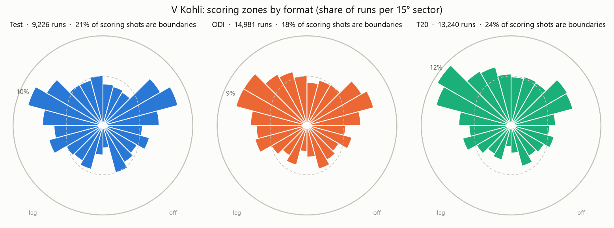

# The Virtual Captain

[](https://github.com/mehulp007/The-Virtual-Captain/actions/workflows/ci.yml)

[](LICENSE)

Field placement in cricket is mostly set on instinct. This project looks at it as a data problem:
given where a batter tends to hit the ball, against a particular type of bowling, where should the
nine fielders stand?

It works from 5.85 million deliveries of Test, ODI and T20 cricket (2001–2026), 3.46 million
of which carry a wagon-wheel point showing where the ball went.


## What the data shows so far

The same batter scores in very different places depending on the ball they get, which is the
whole case for setting a field per batter and per situation rather than per format:

- **Length decides the side of the wicket.** Only 27% of runs off short balls come on the off
  side, against 51% off full balls and yorkers.
- **So does the direction of spin.** Against spin turning away, 44–48% of runs go to the off side;
  against spin turning in, 35–41%.
- **Formats change the shape, not just the volume.** In Tests, 22% of Kohli's runs come through
  the cover region and 23% through mid-wicket. In T20s that becomes 17% and 26%.



| | |
|---|---|
|  |  |

More in [`notebooks/01_eda.ipynb`](notebooks/01_eda.ipynb).

## The deliveries table

`scripts/build_dataset.py` turns the raw CSVs into one Parquet file (about 110 MB, 75 columns,
20 seconds to build). Each row is a delivery with:

- **Match state before the ball:** score, wickets, legal balls bowled, balls remaining, chase
  target and runs required.
- **Phase of play:** powerplay / middle / death for T20 and ODI (The Hundred uses its own 25-ball
  powerplay), new ball / old ball for Tests based on the age of the ball. Defined in
  [`configs/formats`](configs/formats).
- **Bowler type:** fast, medium, finger spin or wrist spin, plus arm, whether the stock ball turns
  into or away from the batter, and whether bowler and batter are on the same side.
- **Venue features** standing in for pitch conditions: runs per ball, boundary rate and the share
  of wickets taken by spin at that ground, shrunk towards the format average for grounds with
  little data. Computed from matches before 2025 so later seasons can be held out.
- **Tracking where available:** line, length, shot, control, and the wagon-wheel point converted
  to metres on the field.

### Field coordinates

Positions are in metres with the origin at the centre of the pitch, the bowler's end at +y, and
the off side of a right-hander at +x. Left-handers are mirrored into the same frame.

The wagon-wheel distance is a fraction of the boundary radius. To turn that into metres, the
boundary radius was fitted against Cricinfo's own "inside the 30-yard circle" flag using the real
shape of the fielding ring (two 30-yard semicircles around each set of stumps, joined by straight
lines). A 68 m boundary reproduces the flag on **98.8%** of tracked balls, which also confirms
that the wagon wheel is measured from the centre of the pitch rather than from the batter.

### Tracking coverage

Share of legal deliveries with each tracking field (men's cricket):

| Format | Years | Balls | Wagon point | Line & length | Shot & control |
|---|---|---:|---:|---:|---:|
| Test | 2001–13 | 764k | 65% | – | 97% |
| Test | 2014–19 | 504k | 77% | 95% | 100% |
| Test | 2020+ | 441k | 77% | 100% | 100% |
| ODI | 2001–13 | 620k | 72% | – | 94% |
| ODI | 2014–19 | 341k | 78% | 81% | 87% |
| ODI | 2020+ | 375k | 67% | 77% | 77% |
| T20 | 2001–13 | 190k | 67% | – | 78% |
| T20 | 2014–19 | 363k | 55% | 59% | 62% |
| T20 | 2020+ | 1,092k | 53% | 61% | 61% |

The full table, including women's cricket, is written to [`reports/coverage.csv`](reports/coverage.csv).

## Setup

Requires [uv](https://docs.astral.sh/uv/). Python 3.12 is picked up or installed automatically.

```bash
# with an NVIDIA GPU (CUDA 12.8 wheels)
uv sync --extra cu128

# CPU only
uv sync --extra cpu
```

Then download the data, build the table and draw the figures:

```bash
uv run python scripts/download_data.py
uv run python scripts/build_dataset.py
uv run python scripts/make_figures.py
```

The Kaggle download needs an API token ([how to set one up](https://www.kaggle.com/docs/api)).
`--source kaggle` or `--source cricsheet` fetches one source only.

Checks:

```bash
uv run pytest
uv run ruff check .
uv run pre-commit install   # optional, lint on every commit
```

## Project layout

```
configs/formats/        phase definitions per format
scripts/                download, build and figure scripts
src/virtual_captain/
  data/                 loaders, match state and phase features, wagon-wheel coordinates
  field/                field geometry (ring, boundary, frames)
  models/               bowler and venue context
  viz/                  field drawing, wagon wheels and scoring-zone roses
notebooks/              exploration
reports/                coverage report and figures
tests/
```

## Data sources

| Source | What it provides |
|---|---|
| [The Ultimate Ball-by-Ball Cricket Dataset](https://www.kaggle.com/datasets/ariadaikalam/the-ultimate-ball-by-ball-cricket-dataset) | Every ball of international and major T20 league cricket, joined with Cricinfo tracking: wagon-wheel position, line, length, shot type and shot control |
| [Cricsheet](https://cricsheet.org/) | Open ball-by-ball match data |

## Credits and licence

Code is MIT licensed. Ball-by-ball data comes from [Cricsheet](https://cricsheet.org/) under the
Open Data Commons Attribution License. Tracking fields derived from ESPNcricinfo are used for
non-commercial purposes only, with credit to ESPNcricinfo.
