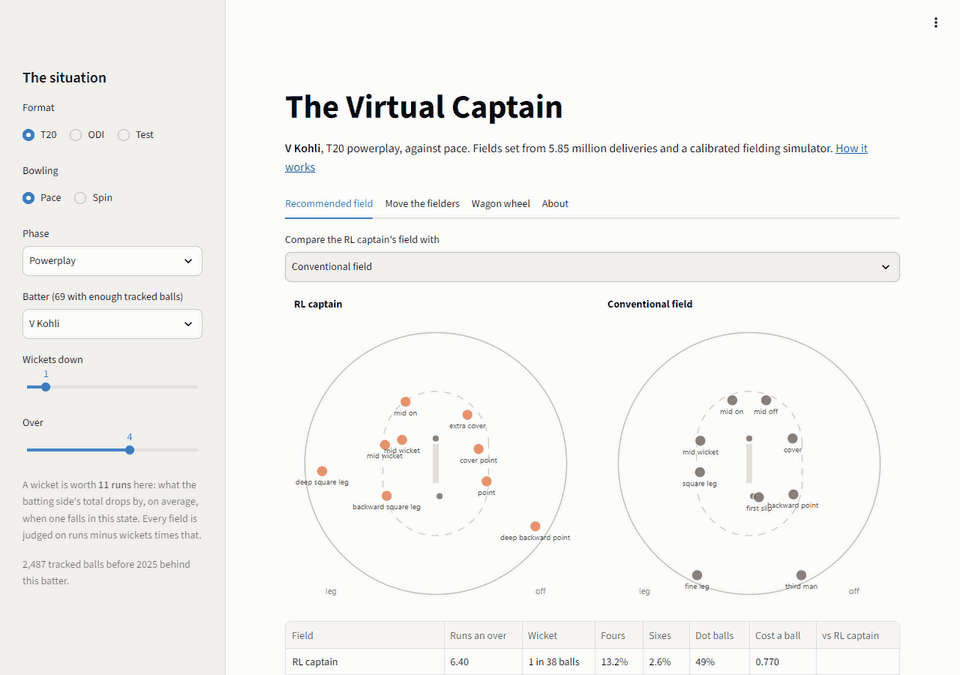
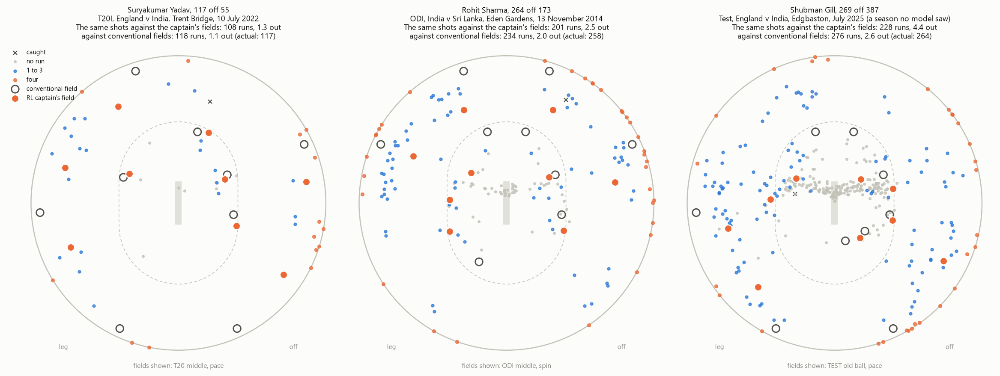
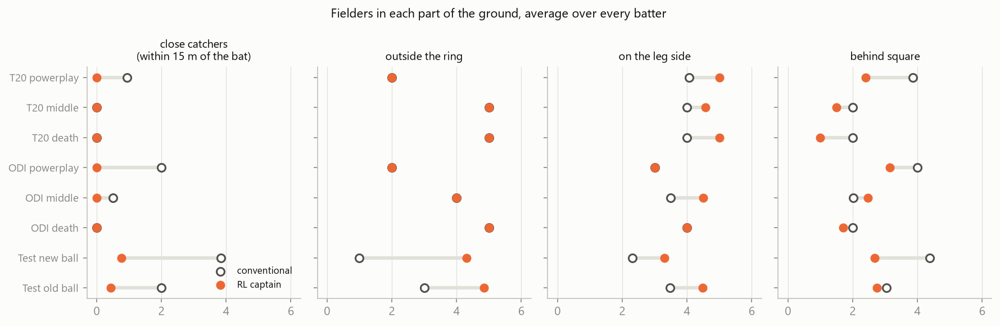

# I built a cricket captain out of 5.85 million deliveries. Here's where it disagrees with the textbook

Every field you see on television is a guess. A good guess, made by someone who has watched the
batter for years, but a guess: nobody can try nine fielders in every spot against the same batter
and count the runs. I wanted to see what happens if you can.

This is the story of [The Virtual Captain](https://github.com/mehulp007/The-Virtual-Captain): what
it found, where it disagrees with the fields captains usually set, and which of those
disagreements I would actually believe. You can try it at
[the-virtual-captain.streamlit.app](https://the-virtual-captain.streamlit.app).

## The data knows where the ball went, not where the fielders stood

The raw material is ball-by-ball data for Test, ODI and T20 cricket from 2001 to 2026: 5.85
million deliveries, 3.46 million of them with a wagon-wheel point showing where the ball went.
That is a lot of information about batters. Suryakumar Yadav's runs come from all round the
ground; Kohli's shift from cover in Tests to mid-wicket in T20s; against short balls only 27% of
runs come on the off side, against 51% off full ones.

What the data does not have is a single fielder's position. Not one. So the first decision was
that everything about fielders had to come from a simulator, and that the simulator had to be
checked against real outcomes rather than taken on trust.

## Four pieces

**A shot model.** A neural network (a mixture density network) that predicts, for a batter, a
bowler and a particular ball, whether it is put into play and, if so, its direction, distance and
whether it is in the air. Tested on the 2025 and 2026 seasons, which it never saw, it gives real
shots about 1.6 times the likelihood that each batter's own smoothed wagon wheel does.

**A fielding simulator.** Fielders react, run and dive; catches get harder the less time a
fielder has; batters run if there is time. It is compiled with Numba and plays about six million
deliveries a second on a laptop. Because the real fields are unknown, I replayed history against
stand-in fields (the textbook field, with its boundary riders moved to where that batter hits)
and fitted the uncertain parameters until simulated runs, boundaries, dots and catches matched
reality. On the unseen seasons, runs per ball are within about 8%.

**A price for a wicket.** A field that saves runs but never takes a wicket is not a good field.
Every field is judged on runs conceded minus wickets taken, with each wicket worth the runs it
costs the batting side at that stage, measured from the data: about 13 runs in a T20 powerplay,
3 at the death, 38 in a Test.

**Two ways to set the field.** A CMA-ES search finds the best legal field for one batter in one
situation. Then a reinforcement-learning captain, one PPO policy, learns to set the field before
every ball for whoever is on strike, in any format, with the wicket's value moving as the match
does. Finally a second agent plays the batter, choosing how hard to attack and where to aim, and
the two train against each other.

## What it found

Fitting the field to the batter is worth a lot. Averaged over 60 batter scenarios, optimised
fields concede 1.23 runs a ball in T20s against 1.36 for the textbook field: about 16 runs over an
innings. Even a field built by hand from the batter's wagon wheel beats the textbook in 48 of 60
cases, and the search beats that one in all 60.

The single RL captain keeps up with a dedicated search for every batter. Over whole overs, with
strike changing and wickets falling, it saves 0.017 runs a ball in T20s against switching to each
striker's own searched field, and on real 2025 and 2026 deliveries it beats the dedicated search
in 49 of 72 contexts.

Small moves matter. Against David Warner in a T20 powerplay, moving backward point five metres
deeper saves 0.026 runs a ball, give or take 0.003.

## Three famous innings, replayed

The test I enjoyed most: take a famous innings, replay every real shot (its direction, distance,
whether it was in the air) against the captain's field for that exact ball and match state, with
200 rounds of fielding luck per shot, and compare.

| Innings | Runs off the bat | RL captain | Textbook field |
|---|---:|---:|---:|
| Suryakumar Yadav, 117 off 55, Trent Bridge 2022 | 117 | 108 runs, 1.3 out | 118 runs, 1.1 out |
| Rohit Sharma, 264 off 173, Eden Gardens 2014 | 258 | 201 runs, 2.5 out | 234 runs, 2.0 out |
| Shubman Gill, 269 off 387, Edgbaston 2025 | 264 | 229 runs, 4.4 out | 276 runs, 2.6 out |

Two things reassured me. Against the textbook field, the simulator reproduces Suryakumar's 117 to
within a run. And Gill's innings comes from a season no part of the system was trained on.

Two things keep me honest. A batter facing a different field would have played differently; this
only shows how the same shots would have fared. And Gill's four expected dismissals (he was out
once) tell you how readily the simulator holds catches in the deep, which brings me to the
disagreements.

## Where it disagrees with the textbook

**It gives up the slip cordon.** Textbook fields keep two to four close catchers with the new
ball in Tests and one or two in a white-ball powerplay. The captain keeps fewer than one in Tests
and none in limited overs.

**It loads the leg side.** About one more fielder on the leg side in the T20 powerplay and death,
in the middle overs of ODIs and with the old ball in Tests.

**It defends in Tests.** Four fielders outside the ring with the new ball, where convention has
one.

Here is the part that matters for anyone tempted to take this to a captain: I only believe one of
these three. The leg-side shift comes from where runs actually go, which the simulator matches
well, direction by direction. The slips and the defensive Test fields come from a known blind
spot. Cricinfo plots edges with several metres of scatter, so the simulator cannot tell first,
second and third slip apart, and close catches are under-counted. In Tests, where a wicket is
worth 38 runs and catches decide everything, that bias pushes fielders back. Fixing it is the
next job, not a finding.

## A batter who fights back

A field that only works against a batter who doesn't look at it is worth less than it seems. So
the batter got a brain too: before each ball it picks how hard to attack and where to aim. The
cost of forcing your game is fitted from the data. In the tracking data a false shot brings a
dismissal 13.6% of the time against 0.24% for a controlled one, and batters get out more than
their shots explain when their game shifts between phases of an innings.

A batter trained to beat a field gains about a third of a run a ball in T20s, and the surprise is
how little of that depends on the field: batters trained against one field gain almost as much
against any other. Mostly they learn to attack harder, and no arrangement of nine fielders takes
that away. Self-play wins back the part that is about the field. After four rounds, what a
batter can gain falls by 6% in T20s and 17% in ODIs, and the captain ends up harder to exploit
than either fixed field. In Tests the dedicated search stays ahead.

## What I would trust

The rankings more than the run totals: every comparison puts each field in front of the same
simulated deliveries, so differences are measured tightly, but their size depends on a
simulator fitted without ever seeing a real field. Limited-overs fields more than Test fields.
And the general shape of the advice (set the field for the batter, lean towards where the runs
go, keep testing it against a batter who adapts) more than any single position.

The code, the data pipeline, every result and its limitations are in the
[repository](https://github.com/mehulp007/The-Virtual-Captain), and three commands rebuild the
lot.
